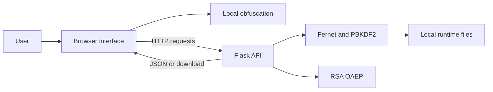

# SecureFlow | Data Security & Cryptography Lab

  

An interactive web application demonstrating the difference between reversible obfuscation and cryptographic encryption. SecureFlow explores password-based encryption, public-key cryptography and the handling of text, files and images through a Flask REST API.

> Educational, local-only prototype. Do not upload real confidential data or deploy this application publicly. The network view is a simulation, not a packet capture or a secure transport implementation.

## Features

| Module | Function |
| --- | --- |
| Obfuscation | Caesar cipher, Base64, XOR, reversal and scrambling |
| Text encryption | Password-based Fernet encryption and decryption |
| RSA | 2048-bit key generation and RSA-OAEP with SHA-256 for short messages |
| File encryption | Encrypt and restore binary files with downloadable outputs |
| Image encryption | Encrypt, restore and preview supported images |
| Network view | Simulated comparison of transmission approaches |
| Comparison | Educational overview of cryptographic techniques |

## Technology stack

Python, Flask, Flask-CORS, Cryptography, PyCryptodome, HTML, JavaScript, Tailwind CSS and Fetch API.

## Architecture



Fernet uses AES-128-CBC and HMAC-SHA256, with a 32-byte combined key derived using PBKDF2-HMAC-SHA256, a random 16-byte salt and 100,000 iterations in this implementation. Files contain the salt followed by the Fernet token. RSA uses OAEP with SHA-256; a 2048-bit key supports at most 190 bytes of plaintext per operation. The modules are separate demonstrations, not an implemented hybrid encryption protocol.

## Run locally (Windows PowerShell)

Use Python 3.11 or 3.12 for the original dependency pins. Internet access is needed for frontend CDN assets and dependency installation.

From the repository root, open terminal 1:

```powershell
cd backend
py -3.11 -m venv .venv
.\.venv\Scripts\python.exe -m pip install -r requirements.txt
.\.venv\Scripts\python.exe app.py
```

In terminal 2, from the repository root:

```powershell
cd frontend
py -3.11 -m http.server 5500 --bind 127.0.0.1
```

Open http://localhost:5500 in a browser. The API runs at http://localhost:5000. Both terminals must remain running.

## Project structure

```text
SecureFlow/
├── backend/
│   ├── app.py
│   ├── crypto_utils.py
│   ├── file_crypto.py
│   ├── rsa_utils.py
│   └── requirements.txt
├── frontend/
│   ├── index.html
│   └── js/
│       ├── api.js
│       ├── main.js
│       ├── obfuscation.js
│       └── ui.js
├── docs/
│   ├── API.md
│   └── REVIEW.md
├── tests/
│   └── test_crypto.py
├── .gitignore
├── SECURITY.md
└── README.md
```

## Tests

From the repository root after installing dependencies:

```powershell
.\backend\.venv\Scripts\python.exe -m unittest discover -s tests -v
```

## Documentation

- [API reference](docs/API.md)
- [Review and limitations](docs/REVIEW.md)
- [Security notes](SECURITY.md)

## Future improvements

- Add HTTPS, authentication and per-user file isolation.
- Improve validation, error handling, file cleanup and dependency maintenance.
- Add a versioned encryption format and evaluate stronger password KDF parameters.
- Add optional hybrid encryption and browser integration tests.

## Author

Tanvi Vijay Pawar — M.Sc. Data Analytics academic project, Network Security and Cryptography.
